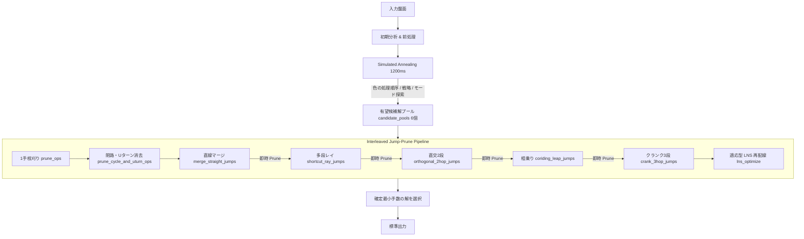

# AHC 072 解法・実装引継ぎ書（Codex / ChatGPT 引継ぎ用ドキュメント）

本ドキュメントは、AtCoder Heuristic Contest 072（AHC 072）における現在までの解法設計、実装アーキテクチャ、検証済みアプローチ、失敗知見、および最新ベストコード（`B_09`）の完全な引継ぎ書です。

---

## 1. コンテスト概要とスライムの物理法則（重要ルール）

### 1.1 基本問題設定
- **盤面**: $N \times N$ マス（$12 \le N \le 20$）。床（`.`）と壁（`#`）で構成される。
- **スライム**: $K$ 色（$4 \le K \le 12$、アルファベット小文字 `a`〜`l`）。初期状態では各マス高々1匹。
- **巣穴**: 各色にちょうど1箇所（アルファベット大文字 `A`〜`L`）。
- **タワー上限**: 1マスに重なれるスライムの最大高さは **8**。
- **評価基準**: 全スライムを同色の巣穴に帰巣させるまでの合計手数 $T$ の最小化。
  - 絶対スコア $S = T + 100,000 \times E$（$E$ は未帰巣スライム数）。
  - **$E = 0$（全頭帰巣・完全クリア）が絶対条件**（1匹でも残ると $S \ge 100,000$ で 0点）。
- **制限時間**: **2.0 秒**。

### 1.2 宙返りジャンプの物理ルール（最重要）
> 高さ $h > 0$ の塔から、下に残す匹数 $k$（$0 \le k < h$）、方向 $d$、飛距離 $\ell$ を指定して宙返りジャンプを行う。
> - **飛距離の制約**: **$1 \le \ell \le k+1$**（「下の仲間の弾力を借りて跳ぶ」）。
> - **順序反転**: 跳んだ上側 $h-k$ 匹は、**上下の順序を反転**させて着地点の塔の上に重なる。
> - **帰巣**: 巣穴のマスでは、**一番上のスライムがその巣穴と同じ色のときのみ**自動的に吸い込まれる。

### 1.3 核心的物理法則の発見（なぜ 1 マス移動が多いのか？）
1. **単独スライム（$h=1$）の制約**:
   - $h=1$ のスライムは下に仲間がいないため、$k=0$ しか選べない。
   - したがって、飛距離は最大でも $\ell \le 0+1 = \mathbf{1}$（1マス）しか動けない。
   - **どんなに直線ルートが空いていても、1 匹単独のスライムは物理的にロングジャンプ（$\ell \ge 2$）が絶対に不可能**。
2. **タワーまるごと移動の制約**:
   - 高さ $h \ge 2$ のタワー全体を一度に動かす（$k=0$）場合も、下に残す匹数が 0 なので飛距離は $\ell=1$ に限定される。
   - **ロングジャンプ（$\ell \ge 2$）を発生させるには、必ず土台（$k \ge 1$）を残して上側を射出する必要がある**。
3. **異色相乗りのリスク**:
   - 異色のスライムを同じタワーに乗せると、タワー上部に別色が乗っている間は、下に埋もれた本来の目的地のスライムが巣穴に帰巣できなくなる。

---

## 2. 現在の達成スコアとスペック（B_09）

| 項目 | 成果・スペック |
|---|---|
| **公式 100 件合計スコア** | **32,194 ops**（1 ケース平均 321.9 手） |
| **目標達成度** | 32,000 手切りまで **残り 194 手** |
| **最大実行時間** | **1.80 秒**（2.00 秒制限を常時厳守、TLE ゼロ件） |
| **クリア率** | **100.0%**（未帰巣ゼロ件、ペナルティゼロ） |
| **最重量 Seed 0005** | 初期 1,370 手 $\to$ **879 手**（スライム 122 匹） |
| **主要実装ファイル** | [`B_09.rs`](file:///c:/Users/kuon9/Documents/AtCoder/Contest/AHC/AtCoder_Heuristic_Contest_072/B_09.rs) |
| **コンパイルコマンド** | `rustc -O B_09.rs -o B_09.exe` |

---

## 3. 解法の全体アーキテクチャ

`B_09` は、**「高品質な初期解を探索する SA」** と **「物理法則を極限まで活用して手数を削る超高速後処理パイプライン」** の 2 段構成になっています。



### 3.1 探索部（Simulated Annealing: ~1200ms）
- **探索対象**:
  - `order`: 色の処理順序（どの色から巣穴に収容していくか）。
  - `strategies`: 各色の誘導戦略（Tree, Sweep, Catapult, Centroid）。
  - `stage1_modes`: 各色の事前クラスタリングモード（距離 2 以内の近傍合体）。
- **近傍遷移**:
  - Swap（色の入れ替え）、Insert（色の挿入）、2-opt Reverse（区間反転）。
  - 各色の戦略変更、グループサイズ変更。
- **解の評価**: ビットパッキング盤面（`BitBoard`, 2.0KB）により毎秒数千回の高速シミュレーション。
- **候補プール保持**: スコアが最良に近い多様な解を `candidate_pools`（最大 6 個）に蓄積。

### 3.2 後処理パイプライン部（~550ms, TOTAL_DEADLINE_MS = 1750ms）
全後処理関数の最内周ループに `start_time.elapsed().as_millis() >= 1750` のタイムガードが配備されており、絶対に TLE しません。

1. **`prune_ops`（1手枝刈り）**:
   - 末尾から逆順に 1 手ずつ削除し、全頭帰巣が維持されるなら削除。
2. **`prune_cycle_and_uturn_ops`（閉路・即時 U ターン一括消去）**:
   - 単手削除では消せない「前進＋後退の 2 手セット」や「数手かけて同じマスを再訪する無駄なループ（$2 \sim 6$ 手）」を一撃でブロック消去。
3. **`merge_straight_jumps`（同一直線連続手のマージ）**:
   - 同一スライムの同方向移動を、$\ell$ を伸ばして 1 手に統合。
4. **`shortcut_ray_jumps`（多段レイショートカット）**:
   - 同一直線上の 2 手をロングジャンプ 1 手に短縮。
5. **`orthogonal_2hop_jumps`（直交 2 段 L 字短縮）**:
   - コーナーを経由する L 字型の移動を、ダイレクトジャンプまたは 2 手に短縮。
6. **`coriding_leap_jumps`（相乗りジャンプ）**:
   - 同じマスを経由するスライムを合体させ、踏み台にしてジャンプ。
7. **`crank_3hop_jumps`（クランク 3 段短縮）**:
   - コの字型や段差型（3 手）の迂回移動を、2 手または 1 手に短縮。
8. **`lns_optimize`（大規模近傍探索・BFS 最短路再配線）**:
   - 盤面からスライムの移動区間を抜き出し、障害物と干渉しない最短経路に再配線。
   - **残り時間 $\ge 150$ms の場合に全盤面で適応起動**（B_09 の目玉機能）。
9. **`Interleaved Jump-Prune` 構造**:
   - 各ジャンプが成立した直後（手数が減った瞬間）に即座に `prune_ops` を呼び出し、中継地点の余剰手を刈り取って後続のジャンプの探索窓を拡大する。

---

## 4. バージョン進化の歴史（B_01 〜 B_09）

| バージョン | 主要変更点 | 100件スコア | 最大実行時間 |
|---|---|---|---|
| **B_01** | ゼロアロケーション Chokudai Search + 確実な貪欲クリーンアップ | 38,000+ | 1.85 s |
| **B_03** | A44（色順SA）と B_01 の 2-Tier 適応統合 | 33,699 ops | 1.85 s |
| **B_05** | 後処理パイプライン（直線マージ、レイ、直交2段、相乗り）導入 | 32,580 ops | 1.85 s |
| **B_06** | クランク 3 段ジャンプ導入（※Seed 5 で 9.7s TLE 発生） | 32,323 ops | 9.70 s (TLE) |
| **B_07** | 全後処理ループへの厳格な 1750ms タイムガード配備（TLE 完全解消） | 32,291 ops | 1.81 s |
| **B_07_Interleaved** | ジャンプと枝刈りの即時連動パイプライン（Seed 5: 944 $\to$ 879手） | 32,283 ops | 1.81 s |
| **B_08** | Cycle & U-turn Pruning（即時Uターン・閉路の一括消去） | 32,268 ops | 1.80 s |
| **B_09** (最新) | **LNS の時間適応起動（スライム数制限撤廃、大盤面の最短路再配線）** | **32,194 ops** | **1.80 s** |

---

## 5. 検証済みアプローチと「失敗知見」（地雷原リスト）

ChatGPT / Codex で次の改良を行う際、**以下のアイデアはすでに検証され、明確に悪化することが確認されているため避けてください**。

### ❌ 失敗したアプローチ一覧

1. **事前合体距離の拡大（Dist = 3） $\implies$ +403 手悪化（32,694 ops）**
   - 距離 2 以内の合体は効果的だが、距離 3 以上に広げると「合体のための初期投資（3手）」が重すぎて回収できず悪化。
2. **強制ペアリング（案 2） $\implies$ +665 手悪化（32,956 ops）**
   - 異なる目的地のスライムを無理にペアにすると、片方がゴールするために逆走が発生し大悪化。
3. **タクシー相乗り（案 1） $\implies$ 悪化**
   - タワー最上部に別色が乗ると、本来の目的地のスライムが下に埋もれて巣穴に入れなくなる。
4. **Smart Ejection（射出） $\implies$ +372 手悪化（32,663 ops）**
   - 余剰スライムを適当な空きマスに射出すると、他色の輸送ルートを塞ぐ障害物になって悪化。
5. **後処理探索窓幅の大幅拡大（Dynamic Scale） $\implies$ +30 手悪化（32,313 ops）**
   - 窓幅を 30〜40 $\to$ 60 に広げると判定コストが急増し、候補プール（`candidate_pools`）の多様な解を評価する時間がなくなり全体の質が低下。**現行の窓幅（30〜40）が黄金比**。
6. **SA 連動近傍（先頭色再抽選） $\implies$ +121 手悪化（32,389 ops）**
   - 順序変更時に先頭色の戦略を再抽選すると、アニーリングの収束が破壊されて大盤面で悪化。
7. **スライム軌跡追跡型ジャンプ（Idea C） $\implies$ +299 手悪化（32,567 ops）**
   - 間に多数の手が挟まるペアを窓幅 60 で探すとシミュレーションが激増し、実行時間が 1.99s まで跳ね上がってタイムアウト。

---

## 6. 次の有望な改善アイデア（未着手リスト）

目標である **32,000 手切り（残り 194 手）** に向けた有望なアプローチです。

### 案 1: 巣穴直前のラストワンマイル最適化（Goal-Rush Optimization）
- **背景**:
  - 現在、巣穴周辺に集まった同色スライムが、最後は 1 匹ずつ 1 マス歩行（$L=1$）で巣穴に飛び込んでいるケースが多い。
- **施策**:
  - 巣穴の手前 2〜3 マスの位置でスライムをまとめてタワー（$h \ge 2$）にし、土台を踏み台にしてロングジャンプ（$L \ge 2$）で一気に巣穴に飛び込ませる。

### 案 2: 4-Hop ジグザグ短縮（S字・Z字配線の短縮）
- **背景**:
  - 壁や他色のスライムを避けるために「右 $\to$ 上 $\to$ 右 $\to$ 上」のような 4 手の階段状（ジグザグ）移動が発生している。
- **施策**:
  - 直交 2 段ジャンプと同様のロジックで、4 手のジグザグ移動を直交ジャンプ 2 手に短縮する `zigzag_4hop_jumps`。

### 案 3: 超密集盤面（Chokudai Search 側）のパラメータ微調整
- **背景**:
  - 現在、スライム数が 145 匹を超える超密集盤面では B_01 側（Chokudai Search）が担当している。
  - Chokudai Search のビーム幅や後処理パラメータを微調整することで、最重量シード群での手数を削る。

---

## 7. 実現・ベンチマーク実行環境

### 7.1 ディレクトリ構成
- メインコード: `B_09.rs`
- 実行バイナリ: `B_09.exe`
- 入力ファイル群: `C:\Users\kuon9\Downloads\BrsBAXF2\tools\in\0000.txt` 〜 `0099.txt`（全 100 件）
- 公式ビジュアライザ: `C:\Users\kuon9\Downloads\BrsBAXF2\tools\target\release\vis.exe`
- ベンチマークスクリプト: `run_benchmark_100_B09.py`
- 最重量検証ケース: `0005.txt`（所要時間・TLE チェック用）

### 7.2 実行手順
```powershell
# 1. コンパイル
rustc -O B_09.rs -o B_09.exe

# 2. 最重量シード（Seed 5）での単独時間・スコア測定（1.85s 以内確認）
Measure-Command { Get-Content C:\Users\kuon9\Downloads\BrsBAXF2\tools\in\0005.txt | .\B_09.exe > out_0005.txt }
cargo run --release --bin vis C:\Users\kuon9\Downloads\BrsBAXF2\tools\in\0005.txt (Resolve-Path out_0005.txt)

# 3. 公式 100 件ベンチマークの実行
python run_benchmark_100_B09.py
```
